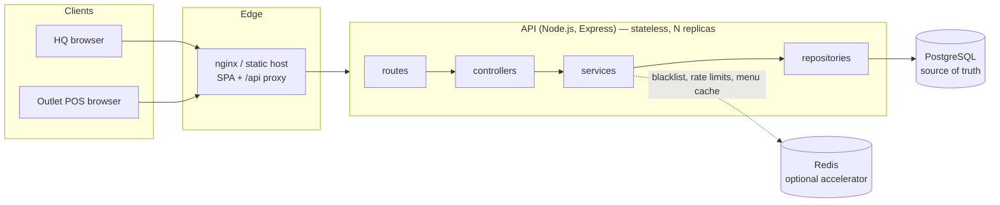

# Architecture

## Overview



- **Frontend:** React 19 + Vite SPA (`source/frontend`). It uses TanStack Query for server state and zustand for session, theme, and the selected outlet.
- **Backend:** Node.js + Express 5 + TypeScript (`source/backend`). It uses Drizzle ORM over `pg`, validates input with zod, and logs with pino.
- **PostgreSQL** is the only source of truth. All invariants (stock, receipt numbers, uniqueness) are enforced there.
- **Redis** speeds things up but nothing depends on it for correctness. It holds the token blacklist, rate-limit counters, and the outlet-menu cache. If Redis is down, the API keeps working: revocation checks fall back to Postgres, rate limiting falls back to per-process memory, and the cache is bypassed.

## Backend layers

```
source/backend/src
├── index.ts                 # HTTP server bootstrap, graceful shutdown
├── app.ts                   # Express app: middleware chain + routers
├── modules/<module>/
│   ├── routes.ts            # URL + middleware (auth, role guard, validation)
│   ├── controller.ts        # HTTP in/out: reads req, calls service, writes envelope
│   ├── service.ts           # business rules, transactions
│   ├── repository.ts        # all SQL (Drizzle); accepts db or a transaction
│   └── validation.ts        # zod schemas for body / query / params
├── shared/config            # env validation (fails fast in production)
├── shared/db                # pool, schema, migrator
└── shared/utils             # auth, validation and error middleware, rate limit, logger, redis, errors
```

Modules: `auth`, `users`, `outlets`, `menu`, `inventory`, `sales`, `reports` (plus `health`).

Rules followed:

- Controllers never touch the database. Repositories hold no business rules.
- Services own transactions (`db.transaction`). Repository functions take the transaction handle as an argument, so a sale's queries share one transaction.
- Services and controllers throw typed `AppError`s. One error middleware turns every error into the response envelope:

```json
{ "status": "SUCCESS" | "FAIL", "message": "…", "data": …, "errors": { "field": "reason" } | null }
```

| Error source                             | HTTP |
|------------------------------------------|------|
| zod validation                           | 422  |
| malformed JSON                           | 400  |
| missing / invalid / revoked token        | 401  |
| role or outlet scope                     | 403  |
| unique violation, insufficient stock     | 409  |
| foreign key / check violation            | 422  |
| DB unreachable / statement timeout       | 503  |
| anything else                            | 500, without leaking internals |

## Request pipeline

`requestLogger (x-request-id)` → `helmet` → `cors` → `compression` → `express.json (100 kb)` → `/api` → `rate limiter` → `authenticate` → `role guard` → `validate` → `controller`

## Security

- **Passwords:** argon2id. Login runs in constant time: a dummy hash is verified when the user doesn't exist, so timing can't reveal which usernames exist. Login and refresh have their own rate limits.
- **Tokens:**
  - Access token: 15 min. Refresh token: 7 days. Both are signed with HS256, or RS256 if key files are configured.
  - `iss`/`aud` are checked, and a `typ` claim stops a refresh token from being used as an access token.
  - The JWT signature is verified before any I/O, so forged tokens cost no Redis or DB round trip.
- **Refresh rotation with reuse detection:**
  - Each refresh token works once, enforced by a single conditional `UPDATE … WHERE status = 'active'`.
  - Presenting a consumed token revokes and blacklists every session of that user.
  - The user's role and outlet are re-read from the database on refresh.
- **Logout:** blacklists the session id in Redis for the remaining access-token lifetime and revokes it in the DB. Redis keeps a "blacklist loaded" marker; if it is missing (Redis restarted without persistence, was flushed, or evicted keys), revocation checks fall back to Postgres and the blacklist is rebuilt from recently revoked sessions. A Redis restart therefore can't bring logged-out tokens back to life.
- **Authorisation:** HQ endpoints require `hqadmin` or `superadmin`. User management requires `superadmin`. Outlet admins are limited to their own outlet in every module, and the check is server-side.
- **Input:** every body, query, and param is parsed with zod, and unknown keys are stripped. Payloads are capped at 100 kb.
- **Transport and headers:** helmet (HSTS, CSP, nosniff …), a CORS allowlist, and `x-powered-by` disabled.
- **Configuration:** production refuses to start without a JWT secret of at least 32 characters or RS256 key files.
- **Containers:** non-root user, production dependencies only, tini as PID 1.
- **Logs:** the `authorization` header, passwords, and tokens are redacted.

## Sale transaction

```mermaid
sequenceDiagram
    participant C as Client
    participant A as API
    participant DB as PostgreSQL
    C->>A: POST /api/sales (Idempotency-Key)
    A->>DB: existing sale for (outlet, key)? → return it (200, replayed)
    A->>DB: BEGIN
    A->>DB: prices = COALESCE(override, base) for items assigned AND active
    Note over A: any item missing → 422, ROLLBACK
    A->>DB: SELECT … FROM inventory … ORDER BY menu_item_id FOR UPDATE
    Note over A: stock < qty → 409, ROLLBACK
    A->>DB: UPDATE inventory … FROM (VALUES …)   -- one statement
    A->>DB: UPDATE outlets SET receipt_seq = receipt_seq + 1 RETURNING
    A->>DB: INSERT sales; INSERT sale_items (bulk)
    A->>DB: COMMIT
    A-->>C: 201 { sale, items, receiptNumber, totalAmount }
```

This was verified with 80 concurrent sales against a stock of 50: exactly 50 succeed with receipts 1–50, 30 get 409, stock ends at 0, and there are no deadlocks. The integration test `tests/sales/service.test.ts` runs the same scenario on every CI build.

## Performance choices

- Count and page queries run in parallel. Reports aggregate in SQL and return only result rows.
- Multi-row inserts and updates for sales. Indexes match the access paths (see [SCHEMA.md](SCHEMA.md)).
- The outlet menu (the endpoint POS terminals hit most) is cached in Redis with version-based invalidation on assignment changes, so there is no stale data.
- Pool limits, `statement_timeout`, and `idle_in_transaction_session_timeout` stop one slow request from tying up the database.
- HTTP keep-alive is tuned above load-balancer idle timeouts. gzip is on. The SPA is code-split per route, and hashed assets are cached for a year by nginx or the static host.

## Related documents

- [Database schema](SCHEMA.md) and [ERD](ERD.svg)
- [Scaling plan](SCALING.md)
- [Evolution to microservices](MICROSERVICES.md)
- [Offline POS strategy](OFFLINE_POS.md)
- [Deploying to Render](RENDER_DEPLOY.md)
