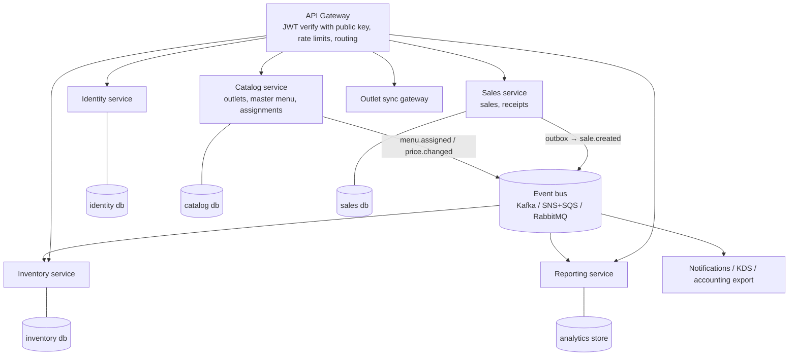

# Evolving into microservices

The system is a **modular monolith**. Each domain (`auth`, `users`, `outlets`, `menu`, `inventory`, `sales`, `reports`) is its own module with routes, controller, service, repository, and validation. Modules only meet at the service layer. Those module boundaries are where the system would split into services.

Splitting is not free: network calls, distributed failure modes, and per-service deploys and monitoring all add cost. It is worth doing when a part of the system needs **independent scaling, deployment cadence, team ownership, or fault isolation**. At 10 outlets that isn't true yet, so the monolith stays.

## Target shape

## Candidate services

| Service | Owns | Why split it | Extraction difficulty |
|---|---|---|---|
| **Identity** | users, sessions, token issuing, revocation | Shared by every other service, and the security-critical code stays in one place. With RS256 (already supported) other services verify tokens using only the public key. | Low: clear boundary, little shared data |
| **Reporting** | rollups, revenue by outlet, top items, exports | Read-heavy and spiky (month-end). Needs a different store (columnar / warehouse). Must never slow down checkout. | Low: read-only, fed by events or CDC |
| **Catalog** | outlets, master menu, assignments, price overrides | Changes rarely and is read constantly, so it caches and CDN-distributes well. Owned by HQ ops. | Medium |
| **Sales** | sales, sale lines, receipt sequences | The revenue-critical write path. Scaled and deployed carefully, isolated from the rest. | Medium-high: needs prices and stock |
| **Inventory** | stock per outlet | High write contention per item. Could later add recipe or ingredient-level stock, transfers, and purchasing. | High: must stay consistent with sales |
| **Outlet sync gateway** | ingest from offline terminals, idempotent batch upload | Different traffic pattern (bursts after reconnect) and protocol. Isolates misbehaving devices. | Low-medium |

## Order of extraction

1. **Add an outbox first, still inside the monolith.** The sale transaction also inserts a `sale.created` row into an `outbox` table, and a relay publishes it to the bus. Events are then never lost or duplicated relative to the database commit. Everything below depends on this.
2. **Reporting.** It consumes `sale.created` and builds its own rollups and warehouse tables. The monolith's report endpoints are routed to the new service. The core write path does not change.
3. **Identity.** Switch to RS256, publish a JWKS endpoint, and have the gateway verify tokens. The token format is already service-friendly: `sub`, `role`, `outletId`, `jti`, `typ`.
4. **Catalog.** Sales keeps a local, event-updated copy of "assigned items and effective price per outlet", so checkout needs no synchronous call.
5. **Inventory and Sales,** together, keeping the hard part correct:
   - **Option A (recommended at first):** Sales and Inventory stay in one service and one database, and the atomic transaction stays as it is today. Stock deduction is the invariant that hurts most to make distributed.
   - **Option B:** separate services using a **reservation saga**. Sales calls `POST /reservations` (idempotent, keyed by sale id). Inventory atomically reserves the stock with the same `UPDATE … WHERE stock >= qty`, then confirms on `sale.committed` or releases on timeout or `sale.failed`. Compensations are idempotent.

## Cross-cutting rules

- **Database per service.** No cross-service joins. Data needed elsewhere (item names in reports, for example) is copied through events.
- **Idempotency everywhere.** The `Idempotency-Key` contract already on `POST /sales` extends to every command and event consumer (deduplicated by event id).
- **Contracts:** OpenAPI for synchronous APIs (already published at `/docs.json`) and versioned event schemas (JSON Schema or Avro) with backward-compatible changes.
- **Resilience:** timeouts, retries with jitter, and circuit breakers on synchronous calls. Checkout must not depend on Reporting or Notifications being up.
- **Observability:** propagate `x-request-id` (already in place) as a trace id with OpenTelemetry, plus per-service SLOs.
- **Platform:** containers (the existing images) on ECS/Kubernetes, one CI/CD pipeline per service, and infrastructure as code.
