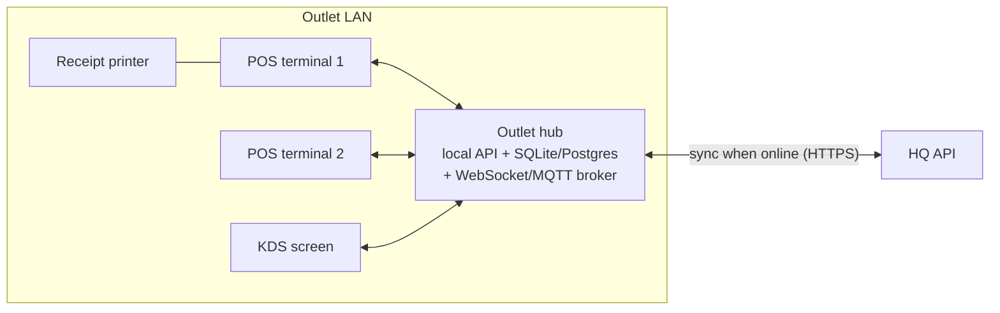

# Offline POS mode

**Goal:** an outlet keeps taking orders, printing receipts, and sending tickets to the kitchen when its internet link is down. Sales reach HQ exactly once when the link returns.

## 1. Topology: an outlet hub on the LAN

- The **outlet hub** is a small always-on box (mini PC or Raspberry-class device, or the main POS terminal). It runs a slim version of the API with a local database and a message broker.
- Terminals and KDS screens talk **only to the hub over the LAN**. The hub talks to HQ when it can.
- Terminals keep a local queue (IndexedDB or SQLite) too, so a terminal that loses even the hub can still take orders. With one terminal and no hub, the terminal acts as the hub.

## 2. Taking sales while offline

What the hub keeps locally, refreshed from HQ whenever online:

- **Catalog:** the outlet's assigned items with effective prices and `is_active`, versioned by the same per-outlet menu version used for caching today.
- **Stock:** the outlet's inventory.
- **Auth:** the outlet admins' credentials or long-lived device tokens, so staff can sign in offline.

A sale created offline:

1. Gets a **client-generated UUID** (`client_sale_id`), used as the `Idempotency-Key` on upload.
2. Gets a receipt number from the hub's **local per-outlet sequence**, using the same gap-free logic as HQ: increment inside the local transaction.
   - With several terminals sharing a hub, all numbers come from the hub, so the series stays sequential.
   - If terminals must work without the hub, use a per-device prefix (`T1-000123`) so numbers never collide.
3. Deducts **local stock** atomically, using the same check as the server.
4. Is written to an **outbox table** on the hub with status `pending`, plus its creation time, terminal id, and staff id.

## 3. Syncing to HQ when the link returns

1. A **sync worker** on the hub detects connectivity (health ping with exponential backoff) and uploads the outbox **in creation order**, in batches of up to 100, to a sync endpoint (e.g. `POST /api/sync/sales`).
2. Each sale carries its `client_sale_id`, so the upload is idempotent:
   - **Already seen:** HQ returns the existing sale. This is the mechanism already implemented for `POST /api/sales` with `Idempotency-Key` and the `(outlet_id, idempotency_key)` unique constraint.
   - **New:** HQ stores it, keeping the offline receipt number and the original `created_at`. Reports then attribute the sale to the right day.
3. The hub marks a sale `synced` only after HQ confirms it, so a crash mid-sync just causes a safe retry. Batches are sent with a sequence cursor so HQ can detect gaps.
4. After pushing, the hub **pulls** catalog changes (newer menu version) and HQ's view of stock.

### Conflicts and how they are resolved

| Conflict | Resolution |
|---|---|
| Same sale uploaded twice (retry, crash) | Idempotency key: HQ returns the original. No double count, no double stock deduction. |
| Offline stock went below HQ's figure (an HQ stock adjustment happened meanwhile) | The sale is a fact that already happened, so HQ **accepts** it. HQ applies the deduction, clamps the outcome, records a **stock discrepancy** event, and flags it on the HQ dashboard for review. Offline sales are never rejected for stock. |
| Price changed at HQ while the outlet was offline | The sale keeps its `price_at_sale` (what the customer paid). The new price applies after the next catalog pull. |
| Item deactivated at HQ while offline | Accepted and flagged, same as above. |
| Receipt-number collision (should not happen with hub or device prefixes) | `UNIQUE (outlet_id, receipt_number)` rejects it. The hub re-numbers with a suffix and logs an alert. |

HQ-only data (master menu, assignments, prices) is **HQ-authoritative** and flows down. Sales are **outlet-authoritative** and flow up. Inventory is the only field both sides change. It is reconciled with an append-only movement log (`sale`, `adjustment`, `transfer`) instead of overwriting absolute numbers, so both sides converge.

## 4. POS ↔ KDS while offline

POS-to-KDS traffic never needs the internet, because it goes over the outlet LAN through the hub:

1. **Transport:** a local broker on the hub, either MQTT (Mosquitto) or a WebSocket server. Topics look like `outlet/{id}/orders/new`, `orders/{id}/status`, and `kds/{station}/tickets`.
2. **Flow:**
   - POS commits the sale locally, then publishes `order.created` (items, notes, table, station routing).
   - KDS subscribes, shows the ticket, and publishes `order.status` updates (`preparing`, `ready`, `served`), which the POS displays.
3. **Reliability:**
   - Messages are published with QoS 1 / acknowledgements.
   - The hub persists open tickets, so a KDS screen that reboots re-subscribes and gets every open ticket again from the hub's state (retained messages or a snapshot request).
   - Messages carry the order UUID, so duplicates are ignored.
4. **Discovery:** terminals find the hub through mDNS (`pos-hub.local`) or a configured static IP, so there is no dependency on cloud DNS.
5. **Degraded mode:** if the hub itself fails, a POS can print kitchen tickets on a networked kitchen printer as a fallback. When the hub returns, open orders are re-published.
6. **Online mode** uses the same path. Kitchen latency stays on the LAN. The hub just additionally forwards events to HQ for kitchen-time analytics.

## 5. What exists in this codebase today

- An `Idempotency-Key` on `POST /api/sales`, a `(outlet_id, idempotency_key)` unique constraint, and replay handling. This is the server half of exactly-once sync, and it is tested under concurrent retries.
- Gap-free per-outlet receipt sequences and atomic stock deduction, which the hub reuses.
- A per-outlet versioned menu cache key, usable by hubs to know when to pull.

Still to build for full offline support:

- the hub service
- the batch sync endpoint that accepts the client's `created_at` and receipt number
- the inventory movement log
- the KDS app and broker
