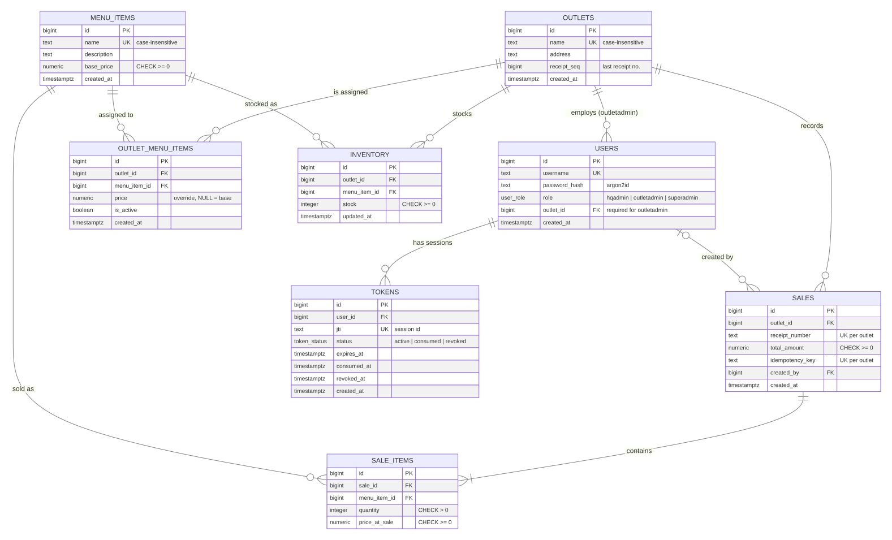

# Database schema

PostgreSQL. Migrations live in `source/backend/drizzle/` (generated from `src/shared/db/schema.ts`).



## Conventions

- **Keys:** `bigint GENERATED ALWAYS AS IDENTITY`. Values stay far below 2^53, so they serialise to JSON numbers without precision loss.
- **Time:** every timestamp is `timestamptz` (stored in UTC).
- **Money:** `numeric(10,2)` for prices and `numeric(12,2)` for totals. The API returns them as strings; totals are computed in integer cents.
- **Integrity in the database, not only in code:** foreign keys, `UNIQUE` constraints and `CHECK` constraints, so a bug or a concurrent request can't produce invalid rows.

## Tables

### outlets

| Column        | Type        | Notes                                                                 |
|---------------|-------------|-----------------------------------------------------------------------|
| `id`          | bigint      | PK                                                                    |
| `name`        | text        | Unique, case-insensitive (`lower(name)`)                              |
| `address`     | text        | nullable                                                              |
| `receipt_seq` | bigint      | Last issued receipt number for the outlet (see *Receipt numbers*)     |
| `created_at`  | timestamptz |                                                                       |

### users

| Column          | Type      | Notes                                                    |
|-----------------|-----------|----------------------------------------------------------|
| `id`            | bigint    | PK                                                       |
| `username`      | text      | Unique                                                   |
| `password_hash` | text      | argon2id                                                 |
| `role`          | user_role | `superadmin`, `hqadmin`, `outletadmin`                   |
| `outlet_id`     | bigint    | FK → outlets. `CHECK`: required when role = outletadmin  |
| `created_at`    | timestamptz |                                                        |

Index: `users_outlet_id_idx`.

### tokens (refresh sessions)

One row per issued refresh token. Rows are rotated on every refresh.

| Column        | Type         | Notes                                     |
|---------------|--------------|-------------------------------------------|
| `id`          | bigint       | PK                                        |
| `user_id`     | bigint       | FK → users (cascade)                      |
| `jti`         | text         | Unique session id; also in the access JWT |
| `status`      | token_status | `active`, `consumed`, `revoked`           |
| `expires_at`  | timestamptz  |                                           |
| `consumed_at` | timestamptz  | nullable                                  |
| `revoked_at`  | timestamptz  | nullable; used to rebuild the Redis blacklist |
| `created_at`  | timestamptz  |                                           |

Indexes: `tokens_user_id_status_idx (user_id, status)`, used to revoke all of a user's sessions; `tokens_revoked_at_idx (revoked_at)`, used to rebuild the blacklist.

### menu_items (master menu, owned by HQ)

| Column        | Type          | Notes                                   |
|---------------|---------------|-----------------------------------------|
| `id`          | bigint        | PK                                      |
| `name`        | text          | Unique, case-insensitive                |
| `description` | text          | nullable                                |
| `base_price`  | numeric(10,2) | `CHECK >= 0`                            |
| `created_at`  | timestamptz   |                                         |

### outlet_menu_items (assignment + price override)

| Column         | Type          | Notes                                                 |
|----------------|---------------|-------------------------------------------------------|
| `id`           | bigint        | PK                                                    |
| `outlet_id`    | bigint        | FK → outlets                                          |
| `menu_item_id` | bigint        | FK → menu_items                                       |
| `price`        | numeric(10,2) | Override; `NULL` means use `base_price`. `CHECK >= 0` |
| `is_active`    | boolean       | Inactive items are listed but cannot be sold          |
| `created_at`   | timestamptz   |                                                       |

- **Unique:** `(outlet_id, menu_item_id)`. Its index also serves "menu for outlet X" lookups.
- **Index:** `menu_item_id` (FK lookups).

An outlet can only see and sell items that have a row here. The effective price is `COALESCE(price, base_price)`.

### inventory

| Column         | Type        | Notes                       |
|----------------|-------------|-----------------------------|
| `id`           | bigint      | PK                          |
| `outlet_id`    | bigint      | FK → outlets                |
| `menu_item_id` | bigint      | FK → menu_items             |
| `stock`        | integer     | **`CHECK (stock >= 0)`**    |
| `updated_at`   | timestamptz |                             |

Unique: `(outlet_id, menu_item_id)`. There is one stock row per item per outlet.

### sales

| Column            | Type          | Notes                                              |
|-------------------|---------------|----------------------------------------------------|
| `id`              | bigint        | PK                                                 |
| `outlet_id`       | bigint        | FK → outlets                                       |
| `receipt_number`  | text          | Sequential per outlet                              |
| `total_amount`    | numeric(12,2) | `CHECK >= 0`                                       |
| `idempotency_key` | text          | From the `Idempotency-Key` header; nullable        |
| `created_by`      | bigint        | FK → users (set null), for auditing                |
| `created_at`      | timestamptz   |                                                    |

- **Unique:** `(outlet_id, receipt_number)` and `(outlet_id, idempotency_key)`. NULL keys don't conflict.
- **Index:** `(outlet_id, created_at)`. It serves sales lists and every report filter.

### sale_items

| Column          | Type          | Notes                          |
|-----------------|---------------|--------------------------------|
| `id`            | bigint        | PK                             |
| `sale_id`       | bigint        | FK → sales (cascade)           |
| `menu_item_id`  | bigint        | FK → menu_items                |
| `quantity`      | integer       | `CHECK > 0`                    |
| `price_at_sale` | numeric(10,2) | Snapshot of the effective price |

Indexes: `sale_id` (receipt lookup and report join) and `menu_item_id`.

## How the schema enforces the business rules

### Receipt numbers

The sale transaction runs:

```sql
UPDATE outlets SET receipt_seq = receipt_seq + 1 WHERE id = $1 RETURNING receipt_seq;
```

- The row lock is held until commit, so concurrent sales at the same outlet take numbers one at a time: 1, 2, 3 …
- If the sale rolls back, the increment rolls back too, so there are no gaps.
- `UNIQUE (outlet_id, receipt_number)` is a backstop.
- Different outlets never contend with each other.

A Postgres `SEQUENCE` was not used. Sequences are non-transactional and leave gaps on rollback, and a POS receipt series is usually expected to be gap-free.

### Stock can never go negative

1. Inventory rows for the sale are locked with `SELECT … FOR UPDATE ORDER BY menu_item_id`. The fixed lock order prevents deadlocks between overlapping sales.
2. Stock is checked under the lock. Any shortfall returns HTTP 409.
3. All lines are deducted in one `UPDATE … FROM (VALUES …)`.
4. `CHECK (stock >= 0)` makes the database reject a negative value regardless of the code path.
